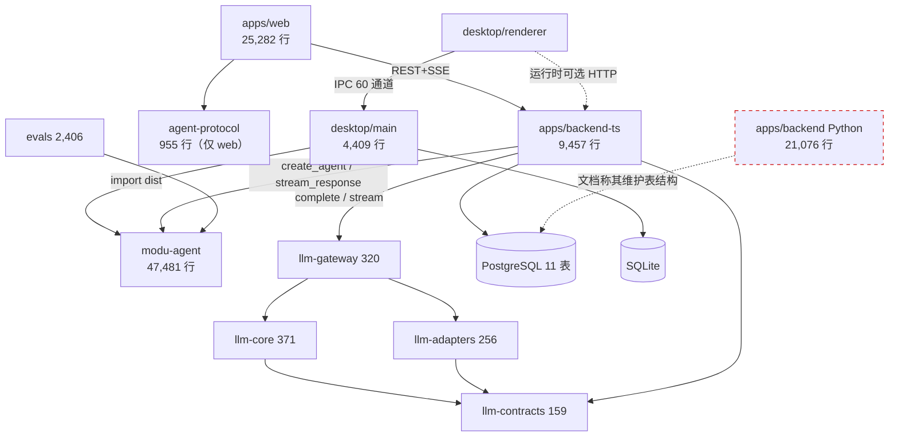
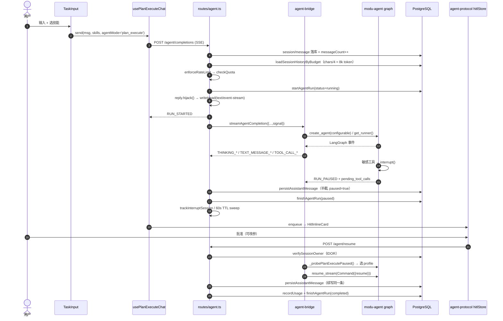

# Pioneering 项目全面评估报告（产品 × 架构）

> **评估范围**：`apps/backend-ts`、`apps/desktop`、`apps/marketing`、`apps/web`、`packages/*`（含 `modu-agent`、`llm-*`、`agent-protocol`、`evals`）
> **评估方式**：全量静态代码阅读 + 契约/注释交叉核验 + 量化统计（行数、同名文件、断言密度、any 密度、实际 import 关系）+ 对既有内部文档的实证比对
> **约束**：本次为**只读分析**，未修改任何业务代码
> **交付**：产品经理（许清楚）负责产品维度，架构师（高见远）负责架构维度，主理人做交叉校验与最终汇编
> **日期**：2026-10-30

---

## 一、执行摘要

### 1.1 项目画像

| 项 | 事实 |
|---|---|
| 仓库形态 | npm workspaces monorepo（但 `apps/desktop` **不在** workspaces 内） |
| 语言 | TypeScript 为主 + **Python 遗留内核仍在仓库中** |
| 非测试源码 | TS/TSX **122,993 行 / 653 文件**；Python **21,076 行 / 122 文件**；合计 **≈144,000 行** |
| 测试代码 | **≈43,137 行**（modu-agent 21,466 / web 11,313 / backend-ts 6,170 / desktop 2,783 / evals 969 / agent-protocol 436） |
| 应用形态 | **4 个可运行前端**：web（云端 SPA）、desktop（Electron + 本地 Agent + 浏览器构建）、marketing（Next 官网） |
| 产品内核 | LangGraph 驱动的 Agent（47,481 行），含 ReAct / Plan-Execute 双图、HITL 三态、工具/MCP/技能、场景包 |
| 后端 | Fastify 5 + Prisma/PostgreSQL（11 表）+ 自建四层 LLM 网关（1,106 行） |
| 一句话 | **一个内核已经相当成熟、外壳严重分裂、质量分布极不均匀的 Agent 平台雏形** |

### 1.2 六条核心结论

**① 这不是一个产品，而是三条独立业务线共用一个代码仓库。**
marketing 卖的是「认知训练 + 创新工作坊 + ¥99/月订阅」（`apps/marketing/data/site/cases.ts:11-15`、`data/site/agent.ts:90-128`）；web 是「强制登录 + 硬编码配额」的通用 AI 对话工作台（`apps/web/src/App.tsx:114-119`、`apps/backend-ts/src/routes/user.ts:142-145`）；desktop 是「自带 API Key + 本地执行 Agent」的开发者工具（`apps/desktop/src/main/key-store.ts`、`main/agent-runtime.ts`）。三者品牌、目标用户、计价模型全部不同，**marketing 全站没有一条链接能到达真实产品**。

**② 品牌有 4 套命名、2 个域名，且工程层已经漂移。**
`创路Agent`（web，`apps/web/index.html:5`）、`Pioneering`（desktop `productName` + marketing `/trends`）、`知境 COGNILAB`（marketing 主站，`data/site/site.ts:5-14`）、`知境智能体`（marketing 产品名）。域名 `cognilab.com` 与 `pioneering.ai` 互不相干。desktop 的 `shared/links.ts:18-26` 注释声称与 marketing 的 `OFFICIAL_SITE` 对齐，**而该常量在 marketing 中并不存在**。

**③ 三模式的切分维度与用户心智正交，缺项成为产品规则。**
模式按「Agent 自主度」切（裸 LLM / ReAct / Plan-Execute），用户按「任务类型」选。结果是：写文章的模式不能预览产物、做分析的模式不能联网、做任务的模式不能深度思考。更关键的是 `apps/web/src/modes/modes-boundary.test.ts:37-41` **用测试强制 chat 不得拥有 HITL**——把一条架构约束固化成产品边界。

**④ 双 Agent 内核 + 双前端 + 双 LLM 通道，构成本仓库最贵的结构性成本。**
Python `apps/backend/ModuAgent`（**18,278 行**，非测试）+ FastAPI 层 2,798 行，与 TS `packages/modu-agent`（47,481 行）并存——双内核合计 **65,759 行**；web 与 desktop renderer 各写一遍产品面（25,282 vs 30,973 行，**文本级重合仅 1.45%**）；`/chat` 走 llm-gateway（有熔断/重试/指标），`/agent` 走 LangChain 自建栈（1,311 行，无熔断）。

**⑤ 工程质量分布极不均匀，且与「是否被真实用户撞过」强相关。**
最高水位：llm-gateway 的流式重试/熔断/超时语义（`packages/llm-gateway/src/gateway.ts:146-250`）、SSRF 防护（`apps/backend-ts/src/routes/web.ts:29-60`）、Electron 安全基线（`apps/desktop/src/main/index.ts:40-52`）、IPC 契约（`shared/ipc-channels.ts` 60 通道）、HITL 暂停态续写同一条消息（`routes/agent.ts:698-748`）。
最低水位：`graph/nodes.ts` 3,368 行、`chatStore.ts` 1,596 行、`routes/chat.ts` 1,288 行、marketing 假表单。

**⑥ "做完了"的定义被降级为"代码写完了"，而不是"接上线了"。**
产品侧：38 个插件仅 3 个可安装（`apps/web/src/pages/Plugins/catalog.ts`）、自动化页 675 行纯本地状态（`AutomationPage.tsx:9` 自述「不与后端调度系统联动」）、体验区假表单（`TryComposer.tsx:6`）、3/5 桌面导航是占位页。
架构侧：`agent-protocol`「共享层」只服务 2 个宿主中的 1 个、OpenTelemetry 1,703 行零接线、`llm-legacy` 回滚开关常驻、`session.runtime` 字段只存不用。

### 1.3 同时必须记入账面的正面结论

只看问题会失真。以下六项是**可量化的硬指标**，放在同类项目里属于上游水位，整改时不应误伤：

| 项 | 实测 | 为什么算高标准 |
|---|---|---|
| **全仓 `@ts-ignore` / `@ts-expect-error` = 0** | grep 全仓零命中 | 说明类型错误在被真修，而不是被压制。多数中等规模 TS 项目做不到 |
| **无运行时循环依赖** | 四个区域共解析 **878 条值边，0 环**（backend 107 / modu-agent 411 / web 211 / desktop 149） | 见 §3.5。团队对模块初始化时序做过认真处理，且 878 条边证明这不是「解析失败导致的假 0 环」 |
| **测试不是凑数** | 未发现空壳测试；modu-agent 最小测试 23 行仍带真实断言 | 43,137 行测试有实质内容（问题在「不在 CI 里」，不在「写了假的」） |
| **LLM 可靠性语义精确** | 流式重试仅 `!emitted` 时、超时后不再重试、ABORT 不计熔断失败（`gateway.ts:146-250`） | 这三条都是踩过坑才会写对的细节 |
| **安全基线到位** | SSRF 双层校验（CIDR + DNS 二次解析）+ Electron sandbox/contextIsolation/CSP + safeStorage 明文不回传 + 管理面 fail-closed 403 | 四项都是"默认做错、需要主动做对"的地方 |
| **架构自律有机制痕迹** | `modes-boundary.test.ts` 用源码文本断言守住模式边界；`kernel/scenario-host.ts` 提供作用域回滚使场景包可真正卸载 | 少见。说明团队想过"怎么防止自己以后走偏" |

---

## 二、产品维度评估
### 2.1 功能定位与价值主张

**实际交付的定位**（以代码为据，不采信文案）：一个「执行过程可见」的云端 Agent 工作台——差异化在工具调用轨迹、Plan 步骤时间轴、HITL 审批/澄清、运行成本核算。模型层极窄，只有 DeepSeek 两个变体（`apps/backend-ts/src/config/models.ts:34-57`，注释明确 P0 主动删除了「可选但不可用」的条目）。

**宣称 vs 交付的逐条比对**（宣称源：`apps/marketing/data/site/agent.ts`，对外最正式的能力承诺）

| # | 对外宣称 | 实际交付 | 判定 |
|---|---|---|---|
| 1 | 多模态理解图文内容 | 附件以 Markdown `` 拼入正文（`apps/web/src/hooks/useAttachments.ts:10-13`）；可用模型 `capabilities` 均无 vision（`models.ts:39,50`） | ❌ 模型看不到图 |
| 2 | 免注册 3 轮对话 | 全部主路由在 `ProtectedRoute` 内（`App.tsx:55,114-119`）；「2/3 轮」是写死文案 | ❌ 无匿名通道 |
| 3 | 知识溯源，每个论断挂可点来源 | 无 RAG、无知识库；内核自述 `status: 'planned'`（`packages/modu-agent/src/config/capability-registry.ts:341-348`）；`rag_agent` 枚举已作为死代码删除（`schemas/agent.ts:7`） | ❌ 核心卖点未实现 |
| 4 | 分档定价 ¥99/月、团队版、私有部署 | 无任何支付/套餐/席位路由；配额硬编码 100 万 tokens / 日 10 万（`routes/user.ts:142-145`） | ❌ 承诺无法兑现 |
| 5 | 插件市场 38 个应用 | 38 项中仅 3 项有安装模板，35 项置灰「即将上线」（`catalog.ts:130,144,157` + `PluginsPage.tsx:385`）；使用量自述「示意文案」（`catalog.ts:7`） | ⚠️ 能力感知严重失真 |
| 6 | 思考路径可视化 | ✅ `GET /agent/runs`、`/messages/:id/plan`、`/executions`（`routes/agent.ts:1165-1325`）+ `run-trace/`、`ProcessPanel`、`TaskPipeline` | ✅ 真实 |
| 7 | 先问后答，1-3 轮澄清 | 仅对 <3 字或高置信模糊短语触发，且 `max_clarify_rounds: 1`（`packages/modu-agent/config.yaml:62-77`） | ⚠️ 严重缩水 |
| 8 | 反问收尾 | 仅 SOUL 提示词约束，`SOUL.md:8-11` 未提该行为 | ⚠️ 无实现载体 |
| 9 | 方法论知识库 | 无；desktop 侧入口是占位页并标注「知识库」（`SidebarNav.tsx:47-49` + `MorePage.tsx`） | ❌ 未实现 |

> **结论**：9 条中 1 条完全真实、3 条部分真实、**5 条不可兑现**。失真集中在「溯源/知识库」（marketing 整个叙事支点）与「定价」（唯一收入模型）。

### 2.2 目标用户与使用场景

| 端 | 反推出的用户画像 | 关键证据 | 画像可信度 |
|---|---|---|---|
| **marketing** | B2B 组织能力买单方：创新负责人、组织发展总监、战略投资经理 | 证言署名与职衔（`data/site/home.ts:133-158`）；案例结构是「12 周工作坊 / 认知训练营」（`cases.ts:11-15`）；数字「12,800 读者 / 340 学员 / 27 机构」自述为原型占位（`home.ts:3`） | 中（内容为原型稿） |
| **web** | 受管控配额下的通用 AI 用户 ≈ 内部试用/邀测 | 强制登录 + 硬编码配额；`/chat` 首屏建议词不绑定行业（`ModeWelcome.tsx:22`）；**分组只落 localStorage**（`store/sidebarGroupsStore.ts:5-8`）→ 说明当前无真实多设备用户 | 高 |
| **desktop** | 自带 API Key 的开发者/重度用户 | 可配后端地址（`settings/sections/ApiConnectionSection.tsx`）、`safeStorage` 受管密钥（`main/key-store.ts`）、本地执行 Agent（`main/agent-runtime.ts`）、全局快捷键（`shared/hotkey-protocol.ts`） | 高 |

**典型场景与落地情况**

| 场景 | 当前落点 | 顺畅度 |
|---|---|---|
| 长文创作 | `/chat` + deepThink + netSearch | ⚠️ 能写，但**无产物预览**（`ArtifactPanel` 只在 task 挂载，`TaskMode.tsx:180`） |
| 深度分析 | `/pro`（react_agent）+ 技能/插件 | ⚠️ 能拆，但**无联网开关**、无产物预览 |
| 多步任务 | `/task`（plan_execute）+ Plan 时间轴 + HITL | ✅ 完成度最高的链路 |
| 决策陪练（marketing 主打） | 无对应能力，只能用自定义 prompt 模拟 | ❌ |
| 图像分析 | 上传转 Markdown 进正文 | ❌ 模型不看图 |
| 企业集成 | 38 个插件点 35 次落空 | ❌ |
| 桌面离线使用 | 本地执行可离线，**会话仍必须落云端**（`agent-runtime.ts:16-19`） | ⚠️ 半自洽 |

### 2.3 功能地图与模块边界

**功能地图（端 → 模块 → 代码位置）**

| 端 | 模块 | 核心功能 | 代码位置 |
|---|---|---|---|
| web | 应用壳 | 侧栏（品牌/模式切换/新建/插件/分组/最近/账号）、顶栏、设置弹窗 | `src/App.tsx`、`layout/Sidebar/Sidebar.tsx`、`components/SettingsDialog.tsx`(874) |
| web | chat | 多轮、deepThink、netSearch、附件、来源面板 | `modes/chat/`(2,699)、`hooks/useAguiChat.ts` |
| web | pro | react_agent、技能/插件、推理过程栏、HITL | `modes/pro/`(3,724)、`components/ProcessPanel.tsx` |
| web | task | plan_execute、Plan 流水线、产物预览、HITL | `modes/task/`(3,573)、`TaskPipeline.tsx`、`ArtifactPreview/` |
| web | 插件·技能 | 目录、安装模板、MCP、技能启停 | `pages/Plugins/`(2,921 含 auth/Help) |
| desktop | 主进程 | 窗口/菜单/CSP、内嵌 Agent、密钥库、本地 SQLite、全局热键、60 IPC 通道 | `main/`(4,409)、`preload/`(449) |
| desktop | 对话区 | 单页 ChatArea + Agent/计划双开关、HITL 三弹窗、时间线、模板画廊 | `components/chat/`(6,803)、`stores/chatStore.ts`(1,596) |
| desktop | 设置 | 11 个 section（含 API 连接 / 安全 / 快捷键 / 本地运行时） | `components/settings/`(4,339) |
| backend-ts | 认证/会话/Agent/系统/上传/用户/MCP/技能/观测/抓取 | 10 个路由文件，约 60 个端点 | `src/routes/`(9,457 全量) |
| marketing | 品牌站 / 产品 / 认知 / 专栏 / 案例 / 关于 / trends | 内容驱动，8 个数据文件 | `app/(site)/*`、`data/site/*.ts` |
| modu-agent | 图/工具/技能/MCP/感知/推理/记忆/演化/观测/场景包 | Agent 内核 | `src/`(47,481)、`packs/`、`skills/` |

**模块边界的三处模糊**

**① web 与 desktop：同一内核，两套完全不同的产品外壳**

| 同一能力 | web | desktop | 冲突性质 |
|---|---|---|---|
| 三档自主度 | 3 个路由 / 3 套页面 / 3 套 hook（`useAguiChat`/`useAgentChat`/`usePlanExecuteChat`） | **1 个 ChatArea + 2 个布尔开关**（`chatStore.ts:144,151`） | 同一心智模型两端呈现方式对立 |
| 设置面板 | 9 分区（账户/通用/对话/用量成本/技能/MCP/数据/帮助/关于） | 10 分区（About/API 连接/Auth/数据/通用/模型/安全/快捷键/系统/本地运行时） | 分区集几乎不重叠 |
| 消息渲染 | 3 套（346 + 552 + 451 行） | 1 套（`MessageBubble.tsx` 373 行） | 全仓 4 套实现 |
| 导航 | 3 模式 + 插件 | 8 页（1 主页 + 对话 + 助理 + 插件 + 自动化 + 我的文件 + 更多 + 工作区） | 信息架构完全不同 |

**② backend 与 modu-agent 的职责渗漏**

| 渗漏点 | 证据 | 后果 |
|---|---|---|
| chat 通道完全绕过 Agent 内核 | `routes/chat.ts:681` 直接 `llmService.chatCompletion(...)`，无 tools/memory/policy/HITL | 「对话」模式是裸 LLM 代理，与「Agent 工作台」主张不是同一系统；技能/MCP 在 chat 全部不可用 |
| Plan 状态双份 | 内核持 checkpoint；backend 又建 `plan_steps` 表 + `/messages/:id/plan` + `/plan/collapsed`（`routes/agent.ts:1207-1274`） | 同一份状态两处维护；desktop（无 Prisma）没有这张表，云/端恢复能力不对等 |
| MCP 配置全局单例 | `routes/mcp.ts:194-200` 读写进程级 `getConfig()`，注释明说「不落盘」，仅有 `authGuard` | **任何登录用户添加的插件对全服可见**；重启即丢 |
| 技能写操作却要 admin | `routes/skills.ts:208-209` `adminGuard` | 同一页面「插件·技能」两 tab 权限模型相反，普通用户必 403 且 UI 无提示 |
| 场景包与模式未绑定 | `config.yaml:97-100` 同时激活 research-pack + planning-pack，与 `:94-95` 注释矛盾 | 两包全局生效 → pro 带任务语气、task 带写作语气，模式差异被配置层抵消 |
| `session.runtime` 只存不用 | `schemas/chat.ts:12` 声明 cloud/local；`routes/chat.ts:188,212,227` 仅回显，**全后端无任何分支读取** | 用户可见但零行为的「假开关」 |

**③ 语义口径分裂**
- `agentMode`：backend 是 `enum('react_agent','plan_execute')`（`schemas/agent.ts:8`）；desktop 是 **boolean**（`chatStore.ts:144`）。同名不同义。

### 2.4 用户体验设计评估

**信息架构的三处反常**

1. **web 根路径无路由**：路由表只有 `/auth/*`、`/help`、`/chat`、`/pro`、`/task`、`/plugins`、`*`（`apps/web/src/App.tsx:97-122`），**没有 `/` 也没有重定向**。用户输入域名直接看到 404。
2. **顶栏在 3 个路由下不渲染**：`App.tsx:61` `{!isTaskRoute && !isProRoute && !isPluginsRoute && <TopNav />}` → 折叠侧栏入口位置随模式漂移。
3. **同一个 `PanelRight` 图标承载三种语义**：展开侧栏（`Sidebar/NavButtons.tsx:42`）、展开推理面板（`TopNav.tsx:52`）、展开任务流水线（`TaskTopBar.tsx:74`）。

**关键交互流程逐段评价（首次进入 → 提问 → 工具/HITL → 产物）**

| 段 | web | desktop | 评价 |
|---|---|---|---|
| ① 首次进入 | `/` → 404 | 首屏即模板画廊（`chat/welcome/TemplateGallery.tsx`） | web 断在第一步 |
| ② 建会话 | 隐式：首次发送时 `create('chat')` + `temp_` 乐观 ID（`ChatMode.tsx:66-87`） | 显式「新建任务」主按钮 | web 有用户不可见的中间态 |
| ③ 提问 | 三模式输入区基本一致（复用 `useTaskInput`），IME/草稿/Enter 统一 | 更成熟：命令面板、文件搜索、文件感知编辑器 | ✅ 输入层是全仓最好的一段 |
| ④ 工具/HITL | `HitlInlineCard` 内联在输入框上方，三态齐备 | `HitlHost` 三弹窗挂在 Router 之外不随路由卸载（`App.tsx:132-133`） | ✅ 两端都做到了「暂停—答复—续跑」完整闭环 + 超时自动拒绝。**这是产品的真正壁垒** |
| ⑤ 产物预览 | **只有 `/task` 有**（`TaskMode.tsx:180`） | 独立右栏 + Mermaid 预览 | ❌ chat/pro 只能从 Markdown 复制 |
| ⑥ 编辑重发 | chat 走专用端点，pro/task 走「编辑重发 + truncateAfter」 | 统一一套 | ⚠️ 同一动作三套实现 |

**三模式能力矩阵（从代码硬证据推导）**

| 能力 | chat | pro | task | 证据 |
|---|:--:|:--:|:--:|---|
| 深度思考 | ✅ | ❌ | ❌ | `chat/ChatInput.tsx:193-203`；`chat.ts:609-611` |
| 联网搜索 | ✅ | ❌ | ❌ | `chat/ChatInput.tsx:204-212`；`chat.ts:660-675` |
| 技能/插件 | ❌ | ✅ | ✅ | `AnalysisInput.tsx:221`、`TaskInput.tsx:216` |
| HITL | ❌ | ✅ | ✅ | `modes-boundary.test.ts:37-41` **测试强制** |
| 运行轨迹 | ❌ | ✅ | ✅ | `ProcessPanel`、`TaskPipeline` |
| Plan 时间轴 | ❌ | ❌ | ✅ | `planExecuteStore`；pro 被测试禁止引用 |
| 产物预览 | ❌ | ❌ | ✅ | `TaskMode.tsx:180` |

> **诊断**：问题不是分层不够，而是**切分维度选错**。且三张模式卡的 desc 都是纯正面描述（`ModeWelcome.tsx:18-40`），**没有任何「该模式不支持 X」的提示**。更贵的是会话被 `conv.mode` 绑定（`Sidebar.tsx:192-198`），切模式即换会话、上下文全丢。

**额外认知负担**：`deepThink` 静默覆盖用户选的模型（`chat.ts:608-611`），而 ModelSelect 仍显示用户所选项——**用户看到的模型 ≠ 实际调用的模型**。

### 2.5 产品问题清单（按严重度）

| 级别 | 问题 | 证据 | 影响 |
|---|---|---|---|
| **P0** | web 无 `/` 路由 | `App.tsx:97-122` | 首次接触即 404 |
| **P0** | marketing 转化终点是假表单 | `TryComposer.tsx:6,43,50`（`setTimeout(700)` 伪装 loading，成功文案自曝「演示环境」） | 全站 6+ 处 CTA 全部落空，流量黑洞 |
| **P0** | marketing 与产品零链接 | 全站 grep 无 `NEXT_PUBLIC_APP_URL` / 产品域名 | 无法导流 |
| **P0** | 38 个插件仅 3 个可用 | `catalog.ts:90-412` + `PluginsPage.tsx:385` | 制造已接入错觉 |
| **P0** | desktop 3/5 导航是占位页且无提示 | `SidebarNav.tsx:30-50` 标 `placeholder:true`，但渲染函数 `:90-118` **从不读该字段** | 点击前无警示，形成「没做完」印象 |
| **P0** | 5 条对外承诺不可兑现 | 见 §2.1 | 摧毁真实优势的可信度 |
| **P1** | 三模式缺项无告知 + 会话绑模式 | `ModeWelcome.tsx:18-40`、`Sidebar.tsx:192-198` | 用户反复试错 |
| **P1** | 产物预览仅 task 有 | `TaskMode.tsx:180` | 长文创作拿不到成品 |
| **P1** | 帮助页指向 `example.com` / `support@example.com` | `HelpPage.tsx:95,118` | 暴露未上线状态 |
| **P1** | 11 个帮助分类中 10 个 `toast('暂未开放')` | `HelpPage.tsx:57` | 帮助中心是壳 |
| **P1** | 隐私政策/服务协议 `href="#"` | `HelpPage.tsx:130,140` | 合规入口不可用 |
| **P1** | 语音按钮无 onClick ×3 | `ChatInput.tsx:221-228`、`AnalysisInput.tsx:226-234`、`TaskInput.tsx:221-229` | 可点击零反馈（desktop 反而正确处理：disabled + tooltip） |
| **P1** | deepThink 静默改模型 | `chat.ts:608-611` | 显示与实际不一致 |
| **P1** | 分组只落 localStorage | `sidebarGroupsStore.ts:5-8` | 换设备即丢，UI 无提示 |
| **P1** | 自动化页 675 行纯本地状态 | `AutomationPage.tsx:9` 自述「不与后端调度联动」 | 看起来能用，实际不执行 |
| **P2** | 同图标三语义、设置目录两套、desktop 首页含 Tech Stack 卡片、`WorkspacePage` 死代码 | 见 §2.3 | 细节失分 |

---

## 三、架构维度评估

### 3.1 技术栈选型

| 层 | 选型 | 实际版本 | 判定 |
|---|---|---|---|
| Web | Vite 6 + React 19 + Tailwind 4 + Radix/shadcn + RR7 + zustand | react 19.3.0 / tw 4.3.3 | ✅ 合理，与 desktop 同源 |
| Desktop | Electron 42 + electron-vite 4 + React 19 + jotai + zustand | react 19.2.7 / tw 4.3.2 | ✅ 选型合理，⚠️ 版本独立漂移 |
| Marketing | Next 15 App Router + Tailwind **3** | next 15.5.27 / tw 3.4.19 | ⚠️ 唯一 TW3 区域，无法复用设计 token |
| API | Fastify 5 + Zod 3 + Prisma 5 + pino + swagger | fastify ^5 / zod 3.25.76 | ✅ 合理（Zod 单一校验源 + 自动 OpenAPI） |
| Agent 内核 | LangGraph 0.2.74 + LangChain core 0.3.80 + MCP SDK 1.x | — | ⚠️ 锁版方式危险，见下 |
| LLM 接入 | 自建四层 contracts→core→adapters→gateway（1,106 行） | — | ✅ 设计质量高，❌ 只覆盖 `/chat` |
| Agent 侧 LLM | `@langchain/openai` + 自建 1,311 行适配栈 | — | ❌ 与网关重复建设 |
| 数据 | PostgreSQL（11 表）+ SQLite（desktop 本地）+ 文件 | — | ⚠️ 双写模型 |
| 测试 | Vitest（全区统一） | 2.x | ⚠️ desktop 未装 `@testing-library/*` → 74 个 tsx 零组件测试 |
| CI | 单 workflow | — | ❌ 覆盖 2/6 区域 |

**版本漂移与腐化点（可直接举证的 5 处）**

1. **`apps/web/vite.config.ts:16-21` 注释完全过期（事实错误）**：注释称「marketing（Next 14）必须用 React 18，根提升 react@18，web 用嵌套 19」。实测根 `react@19.3.0`（唯一一份，**全仓不存在 React 18**），`next@15.5.27`，且 `apps/web/node_modules` 下没有 react。连带 `apps/web/src/test/forceReactSingleton.ts`（72 行双路 `Module._resolveFilename` 劫持）的存在理由已消失，却仍挂在 `setupFiles` 链上——典型的「补丁的前提变了，补丁不敢删」。
2. **Tailwind 双大版本**：根提升 3.4.19（marketing），web 用嵌套 4.3.3，desktop 4.3.2。TW3→TW4 是范式变更（`tailwind.config.ts` → CSS `@theme`），marketing 无法复用任何设计 token。
3. **`better-sqlite3` 跨大版本**：modu-agent `^11.0.0`（optionalDep）vs desktop `^13.0.3`。desktop 主进程同时加载两者，两个 major 的原生模块都要对 Electron 42 的 NODE_MODULE_VERSION 重编译，而 `asarUnpack` 只写了 `**/node_modules/better-sqlite3/**`（`apps/desktop/package.json:94-96`）。
4. **死锁文件仍在库中**：`apps/backend-ts/package-lock.json`（123 KB）内容陈旧（`undici ^6.0.0`，而当前 `package.json` 无 undici 依赖；缺 8 个实际声明依赖）。backend-ts 是 workspace，此嵌套 lock **永不被 npm 消费**。
5. **`@types/node` 20 vs 22**：marketing `^20.17`，backend/packages `^22`；Electron 42 内置 Node 22。跨端共享类型（`shared/types.ts`）受此影响。

### 3.2 目录与模块划分

**五层视图**

```
接入层   apps/web(25,282)   apps/desktop/renderer   apps/marketing(5,333)
              │  HTTP REST+SSE        │ IPC(60 通道) 或 HTTP
              │                       ▼
              │            apps/desktop/main(4,409) ← 内嵌 modu-agent（本地模式）
协议层   packages/agent-protocol(955) ← 仅 web 消费
API 层   apps/backend-ts(9,457)：plugins(7) → routes(10) → core(17) → Prisma
内核层   packages/modu-agent(47,481)：core · config · graph(16,757) · tools · skills
         · memory · mcp · perception · reasoning · feedback · evolution
         · observability · orchestration · kernel(场景装配)
LLM 层   llm-contracts(159) ← llm-core(371) ← llm-adapters(256) ← llm-gateway(320)
数据层   PostgreSQL(11 表) · SQLite(local-chat.db / checkpoints.db) · 文件
遗产     apps/backend（Python 21,076 行）⚠️ 不在 workspaces / CI / start.sh
```

**各包职责与边界判定**

| 包 | 实际边界 | 判定 |
|---|---|---|
| `apps/web` | 完整产品面 + 自有 store/api/SSE 解析 | 边界清晰，但与 desktop 全量重叠 |
| `apps/desktop` | main(IPC+本地 Agent+SQLite) + renderer(完整产品面) + **browser 构建目标** | 事实上的「第二套 web」，且是 web 的超集 |
| `apps/marketing` | 完全独立，零共享 | ✅ 边界干净（代价：TW3） |
| `apps/backend-ts` | 鉴权/配额/限流/幂等/搜索/AG-UI 编码/**Agent 编排**(1,150 行) | ⚠️ **胖宿主**：`core/` 里 7 个文件本属内核或应用服务层 |
| `packages/modu-agent` | 13 个子域 + `kernel/` 场景装配 | 结构完整，但 `nodes.ts` 3,368 行是上帝文件 |
| `packages/llm-*` | 严格四层，依赖方向正确 | ✅ 全仓分层最干净；❌ 零测试；❌ 只服务 `/chat` |
| `packages/agent-protocol` | **只被 web 消费** | ❌ 名不副实（见 §3.5） |
| `packages/evals` | YAML 驱动 + CI 门禁 | ✅ 依赖方向正确 |
| `apps/backend`(Py) | 仍被文档声明为 **DB schema 所有者** | ❌ 事实死亡但仍被依赖 |

**六处边界渗漏**

| # | 渗漏 | 证据 | 影响 |
|---|---|---|---|
| B1 | 路由层承载领域逻辑：`routes/chat.ts` 1,288 行内同时做配额预扣、幂等占位、搜索注入、上下文预算、SSE 手写、落库、regenerate | `routes/chat.ts:383,681,775,843,1217` | 无 service 层，agent 通道只能再写一遍 |
| B2 | backend 是 `create_agent` 的第二装配者（图 LRU 16、graphCacheKey、reset_runner_cache、LLM resolver 注册） | `core/agent-bridge.ts:32-156` | 与 desktop `main/agent-runtime.ts:28-70` 逐条对应 → 两份实现 |
| B3 | 内核读密钥绕过统一密钥源：`apiKey: env.LLM_API_KEY` | `agent-bridge.ts:141-153` vs `core/llm-gateway.ts:11-16` 的 `resolveLlmSecrets`（支持 file provider） | 生产用 `SECRET_PROVIDER=file` 时，`/agent` 仍读 env，双来源必有一份配错 |
| B4 | `core/*` 出现宿主私有概念（技能白名单持久化、按 env 激活场景包） | `core/skill-state.ts:15`、`core/scenario-boot.ts:15` | 内核能力被切成「内核实现 + 宿主开关」 |
| B5 | `MODE_DOMAIN` 硬编码模式→领域映射 | `agent-bridge.ts:161-164` | 新增模式须改后端代码，破坏配置驱动叙事 |
| B6 | ✅ **packages 无反向依赖 apps** | `grep -rn "apps/" packages/*/src` 零命中 | 做对了，应保持 |

**包依赖图（实际 import 关系）**



> **图上最重要的一个事实**：`modu-agent` **完全不 import `llm-*`**（grep 零命中）。`BE→MA` 与 `BE→GW` 是**两条互不相通的 LLM 出口**。

### 3.3 服务间通信

**① 前端 ↔ backend（REST + SSE）**

- 契约统一 `{code, data, message}`（`plugins/response-wrapper.ts` 注入，`apps/web/src/api/client.ts:176-181` 对称解包）。
- 鉴权：JWT（2h）+ refresh token 落库（30 天），**存储在 localStorage/sessionStorage**（`client.ts:12-15,20-30`）。401 自动刷新用 `refreshPromise` 单飞去重（`:57-94`）——并发处理正确，但**缺刷新失败的全局登出广播**。
- SSE：服务端 `reply.hijack()` 后裸写 `reply.raw`，须**手动补 CORS 头**（`routes/chat.ts:784-789` 与 `routes/agent.ts:590-595` 几乎逐行重复）。心跳 15s。
- **两条通道断线恢复能力不对等**：
  - `/chat/completions`：有 `runEventHub`，每帧带 `seq` 与 `id:`，支持 `Last-Event-ID` 回放，断连后继续缓冲 → **断线可续**。
  - `/agent/completions`：**无任何回放**，且 `reply.raw.on('close')` 立即 `abort` 上游 → **切网即杀整轮 run**，只留半截消息。

**② desktop 主进程 ↔ 渲染进程（IPC）**

`shared/ipc-channels.ts`（325 行）定义 **60 个通道**，枚举 + 载荷类型 + 与 REST 的语义映射表写在注释里。分组：窗口控制（含纯 IPC 拖拽绕开 `-webkit-app-region` bug）、应用、快捷键、文件/剪贴板/通知、Store、**Agent 本地运行时**（`agent:send/resume/abort/state/stop` + `agent:event` 单向推流）、**本地会话**（SQLite DAO）、**密钥**（`safeStorage` 加密，明文永不回传渲染端，只回掩码）。

> 评价：**这是全仓最规范的一层**。风险是 `main/ipc-handlers.ts` 1,148 行单文件承载 60 个 handler。

**③ backend ↔ modu-agent**

**进程内同步函数调用**，同堆共享 checkpointer 单例。并发模型：Node 单线程 + 每请求一个 `AsyncGenerator`；图缓存在模块级 `Map`（LRU 16）。取消链路完整：`AbortController` → `signal` → `stream_response(..., signal)` → LangGraph abort + 上游 fetch abort，且**用户取消不计熔断失败**（`gateway.ts:190`）。
**背压：没有。** `reply.raw.write()` 返回 `false` 时不等待 `drain`（`chat.ts:815`、`agent.ts:678`）；`runEventHub` 的 `maxEvents: 10_000` 只限回放缓冲，不限 socket 写缓冲。

**④ backend ↔ llm-gateway ↔ provider（可靠性机制的正确性）**

| 机制 | 参数 | 位置 | 评价 |
|---|---|---|---|
| 流式重试 | `maxAttempts: 2`，仅 `!emitted` 时 | `gateway.ts:183-198` | ✅ 避免正文重复 |
| 非流式重试 | `withRetry` + `!timedOut && err.retryable` | `:222-241` | ✅ 超时后不再重试 |
| 空闲超时 | `idleTimeoutMs`（默认 60s），每 chunk `refresh()` | `:150,173` | ✅ 语义正确（不限总量） |
| 熔断 | 按 `model.provider` 维度 | `:160,179,191,243,250` | ✅ ABORT 计成功 |
| 退避 | `backoffDelay(attempt, 300, 3000)` | `:194-197` | ✅ |

> **这是全仓工程质量最高的一段代码。问题不在实现，在覆盖范围**——见结论 ④。

**⑤ 通信链路属性总表**

| 链路 | 错误传播 | 背压 | 重试 | 断线恢复 |
|---|---|---|---|---|
| web → backend REST | `{code,message}` + HTTP status | HTTP 天然 | ❌ | 用户重试 |
| web → `/chat/completions` SSE | `RUN_ERROR` 事件 | ❌ | ❌ | ✅ `Last-Event-ID`（5 min 进程内） |
| web → `/agent/completions` SSE | `RUN_ERROR` 事件 | ❌ | ❌ | ⚠️ 仅靠 HITL resume，流本身不重放 |
| desktop renderer → main | reject | Electron 队列 | ❌ | ❌ |
| backend → modu-agent | throw → `RUN_ERROR` | ❌ | ❌ | checkpointer |
| backend → llm-gateway → provider | `LLMError`（有限错误码） | ❌ | ✅ 2 次 | 已产出增量不重试 |
| modu-agent → provider | LangChain 异常原样上抛 | ❌ | ✅ 独立实现 | ❌ |
| backend → Web 搜索 | try/catch 降级 | — | ✅ 3 次（**第三套重试**） | — |
| modu-agent → MCP | `MCPConnectionError` | SDK 管理 | 懒重连 | 清缓存重连 |

### 3.4 数据流与状态管理

**一次 Task 模式请求 + HITL 审批的完整时序**



**做对的四点**
1. **暂停时落半截消息，resume 续写同一条**（`routes/agent.ts:698-748` 注释详述了「刷新后回复消失」的缺陷史）——被真实用户报告驱动出的设计。
2. **resume 前探测 `plan_phase='executing'`** 决定用哪个 profile 的图（`agent-bridge.ts:446-521`），注释直接引用了 LangGraph 报错原文。
3. **IDOR 双重校验**：路由层 `verifySessionOwner` + `getPendingAgentState` 内再校验 `state.user_id`。
4. **`contentBlocks` 严格保序**，是历史回放的唯一数据源。

**三个缺口**
1. `/agent/completions` 无 `runEventHub`：过程中的 delta 全部丢失，刷新后只能靠 DB 重建。
2. `recordUsage` 在 `paused`/`error`/`abort` 时**跳过**（`routes/agent.ts:729,1014`），**但 token 已真实消耗** → 「生成一半点停止」= 免费。
3. `ctx.paused` 与 `ctx.runPaused` 两个相近布尔量并存（`agent-bridge.ts:202-204`），语义差异只写在注释里。

**前端状态分层**

| 端 | 范式 | 规模 | 问题 |
|---|---|---|---|
| web | zustand 单一范式 | 6 store / 1,420 行（`conversationStore` 372、`planExecuteStore` 349、`sidebarGroups` 161…） | ✅ 干净 |
| desktop | **jotai + zustand 双库** | 2,750 行；jotai 被 39 个源文件 import，zustand 5 个 | ❌ 见下 |

> 双状态库的可量化代价：`artifactStore.ts`/`authStore.ts`/`rightPanelStore.ts`/`lightboxStore.ts` **文件名带 Store 但内部是 jotai atom**（看名字无法判断范式）；1,596 行 `chatStore.ts`（zustand）+ `traceAtoms.ts`（jotai）共同管一次流式 run → 同一份流数据跨两个库同步。**同一功能，desktop 用两套范式写了 1,596 行，web 用一套写了 372 行。**

**持久化模型**

Prisma 11 表：`users`、`refresh_tokens`、`chat_sessions`、`chat_messages`、`files`、`token_usage`、`user_quotas`、`agent_tool_executions`、`plan_steps`、`agent_runs`（+ 被注释掉的 `ai_configs`）。

三个做对的设计：`chat_sessions.model` 存**别名**而非真实 model id（模型升级不迁历史）；`plan_steps.duration_ms` 是 DB 生成列，TS 侧**绝不写入**；`AgentRun.id === traceId === runId`。
一个风险：**双真源**——`chat_messages.contentBlocks`（消息级完整）与 `agent_runs.events`（run 级裁剪，`TIMELINE_MAX_EVENTS=300`）无一致性校验，超限后回放会缺尾。

**Agent 状态**

| 项 | 实现 | 证据 |
|---|---|---|
| thread_id | = `sessionId` | `agent-bridge.ts:469` |
| checkpointer | 配置写 `sqlite`，实现 `SqliteSaver.fromConnString`；失败**静默降级** `BoundedMemorySaver`（LRU 100） | `graph/factory.ts:201-241` |
| interrupt 载荷 | 存 checkpoint state（kind/message/question/options/pending_tool_calls…） | `agent-bridge.ts:574-589` |
| TTL 清理 | 60s 扫频，300s 超时自动拒绝 | `agent-scheduler.ts:17,41-59` + `config.yaml:38-40` |

> ⚠️ **本仓最危险的一处「配置说 A、运行是 B」**：`config.yaml:6` 声明 `checkpointer_type: sqlite`，但 `@langchain/langgraph-checkpoint-sqlite` 与 `better-sqlite3` 都是 **optionalDependencies**。任一缺失/原生编译失败 → `catch` → `_sqliteSaverUnavailable = true` → **永久降级内存**，只在启动日志打一行 warning（`factory.ts:225`）。后果链：重启后 HITL 暂停态全消失 → 前端显示「待确认操作已失效」→ `/agent/resume` 抛 `Branch condition returned unknown or null destination`。

### 3.5 依赖关系与耦合度

**循环依赖：未发现真实的运行时环**

采用「区分 `import type`（编译期擦除，不产生运行时边）与值导入」的口径逐条复核后，四个区域均无运行时循环依赖：

| 区域 | 文件数 | 运行时值边 | 被跳过的 type-only 边 | **运行时环** |
|---|---:|---:|---:|---:|
| `apps/backend-ts/src` | 47 | 107 | 0 | **0** |
| `packages/modu-agent/src` | 168 | 411 | 124 | **0** |
| `apps/web/src` | 162 | 211 | 50 | **0** |
| `apps/desktop/src` | 161 | 149 | 32 | **0** |

> 边数一栏的作用是自证「不是解析失败导致的假 0 环」：411 条值边全部解析成功且无环，比「0 条边所以 0 环」可信得多。

**四处具体判定**

| 区域 | 关键边 | 判定 |
|---|---|---|
| web | `useAgentChat.ts:11` 值导入 `contentBlocksToSteps`；反向 `contentBlocksToSteps.ts:9` 是 `import type { AgentStep }` | 单向，无运行时回边 |
| desktop | `chatStore.ts:43` 是 `import type`（擦除）、`:44` 依赖叶子模块 `hitl-bridge`；`hitlStore.ts:23` → `chatStore` 是唯一运行时边 | 单向 |
| desktop | `hitl-bridge.ts:22` 是 `import type`；`hitlStore.ts:24` 值导入 `bindHitlStore` 并自注册 | 单向 |
| desktop | `shared/links.ts` 49 行、零 import，是纯常量文件 | 不存在 |

> **这一节经过一次结论修正，过程本身值得记录**：初版检测用正则抽取 `from '...'`，未区分 `import type`（编译期擦除）也未剥离注释，得出 4 个环；复核后全部为假阳性——其中 `shared/links.ts` 是 49 行零 import 的纯常量文件，而被判成「自引用」的其实是注释里那句「主进程 import from '../shared/links'」。修正后的检测器补上了 `.js → .ts` 的 NodeNext 解析（否则值边全部解析失败，会得到「假 0 环」）、注释状态机、以及 type-only 判定。
>
> **「无环」是一个应当记入账面的正面结论**——它说明团队对模块初始化时序有过认真处理，不是侥幸跑通。但 0 环之下有两条更值得注意的观察：

**观察 ①：防环靠人工纪律，没有机器门禁——「已修好但未上锁」**
`chatStore.ts:41-43` 的注释是直接证据：「T8 修复：不再顶层 import hitlStore（消除双向循环依赖），类型仅用 type-only import」。也就是说这个环**曾经真的存在**，靠「工程师记得写 `import type`」+ `hitl-bridge` 两层手法修掉。当前 0 环依赖的是人的记忆：一旦有人在 `chatStore` 里补一句 `import { useHitlStore } from './hitlStore'`，环立刻回来，而**全仓没有任何工具会拦住它**（无 `madge --circular` / `dependency-cruiser` / `no-restricted-paths` 进 CI）。

**观察 ②：同一套防环手法也被实现了两遍**
`packages/agent-protocol/src/hitl-bridge.ts:1-10` 与 `apps/desktop/src/renderer/src/stores/hitl-bridge.ts:1-12` 是两份同源实现，各自都写着「切断 chatStore → hitlStore 的 ESM 静态环依赖 / 单向桥接（T8 修复）」。**桥接模式本身没问题，问题是它和它守护的状态机一样被复制了**——这与「有无环」是两个独立问题。

**扇入 / 扇出**

- 扇入健康：web 最高 `types/chat` 14 次、`api/client` 11 次；desktop 最高 `shared/ipc-channels` 8 次。没有 God Module 被 50 个文件依赖。
- **扇出异常**：`agent-bridge.ts` 一次从 `@pioneering/modu-agent` 导入 **13 个符号**。根因是 `modu-agent/src/index.ts` 的 **17 个 `export *`**。该文件 `:40-41` 的注释正在为此打补丁（「显式声明可规避 `export *` 同名歧义，歧义名字会被顶层排除」）——**这是已经被 barrel 咬过一次的证据**。

**上帝文件 Top**

| 文件 | 行数 | 判定 |
|---|---:|---|
| `packages/modu-agent/src/graph/nodes.ts` | **3,368** | ❌ 单文件承载 ReAct 全部节点 |
| `packages/modu-agent/src/orchestration/communication/agui-adapter.ts` | 1,896 | ⚠️ 19 种事件状态机 |
| `apps/desktop/src/renderer/src/stores/chatStore.ts` | 1,596 | ❌ |
| `packages/modu-agent/src/graph/runner.ts` | 1,559 | ⚠️ |
| `apps/desktop/src/renderer/src/components/chat/input/InputArea.tsx` | 1,426 | ❌ |
| `apps/backend-ts/src/routes/agent.ts` | 1,357 | ❌ 路由层 |
| `apps/backend-ts/src/routes/chat.ts` | 1,288 | ❌ 路由层 |
| `packages/modu-agent/src/graph/factory.ts` | 1,219 | ⚠️ |
| `apps/backend-ts/src/core/agent-bridge.ts` | 1,150 | ⚠️ |
| `apps/desktop/src/main/ipc-handlers.ts` | 1,148 | ❌ |

**web 与 desktop 的重复实现量化**

文本级重合度（≥40 字符行去重后取交集）：**140 / 9,639 = 1.45%**。

> 这个数字很关键：它说明两端**不是复制粘贴，而是同一产品面被独立实现了两遍**。因此不能靠「抽取公共组件」解决——连函数命名、状态结构、props 形状都不一样。

| 产品面 | web | desktop | 判定 |
|---|---|---|---|
| 会话/消息渲染 | `components/message/` + 3 套 mode 消息列表（1,349 行） | `components/chat/`(6,803) | 全量重写 |
| Markdown | `Markdown.tsx` + `hast-util-sanitize` | `MarkdownRenderer.tsx` + `react-markdown` | 两套 sanitize 策略 |
| 产物预览 | `ArtifactPreview/`(370) | `preview/`(435，含 Mermaid) | desktop 更强 |
| 设置面板 | `SettingsDialog.tsx`(874) | `components/settings/`(**4,339**) | desktop 是 web 的 5 倍 |
| HITL | `agent-protocol` 的 `HitlInlineCard`(188)+`HitlToolConfirmBody`(210) | `components/hitl/`(456) + **自有 `hitlStore.ts`(318)** | ⚠️ 分叉未收敛（diff ≈300 行） |
| API 客户端 | `src/api/`(1,390, fetch) | `services/api/` + `transport/`(axios) | 两套 HTTP 栈 |
| SSE 解析 | **2 份**：`parseAguiStream.ts`(295) + `sseClient.ts`(335) | **1 份**：`agui.ts`(392) + `stream-handler.ts`(620) | 全仓 3 份解析器 |
| 基础 UI 原语 | `components/ui/` 20 文件 | `components/ui/` 15 文件 | **10 个同名文件全部 DIFF** |

**shadcn 原语已分叉（10 对同名文件，逐个 DIFF）**

| 文件 | web | desktop | 文件 | web | desktop |
|---|---:|---:|---|---:|---:|
| avatar | 48 | 41 | dropdown-menu | 193 | 173 |
| button | 66 | 62 | input | 22 | 26 |
| card | 73 | 75 | label | 21 | 25 |
| dialog | 126 | 109 | radio-group | 42 | 46 |
| scroll-area | 50 | 44 | tooltip | 28 | 27 |

> 同一 shadcn 模板被复制两次后各自被改过。**一次 Radix 大版本升级要改 20 个文件。**

**同一 app 内的荒诞样本**

`apps/web/src/modes/{chat,pro,task}/hooks/useChatSync.ts` —— **3 份 80 行文件，MD5 完全相同**（`903fcf78…`）。而 `outputs/web-UI栈对齐重写-实现度核验报告-2026-10-06.md` 自己写过「三份 useChatSync 直接废弃」。**未废弃。**

**共享层覆盖率：50%（1/2 端）**

| 包 | web 消费 | desktop 消费 |
|---|---|---|
| `@pioneering/agent-protocol` | ✅ 11 个文件 | ❌ 0 文件，**不在 package.json** |
| `@pioneering/modu-agent` | ❌ | ✅（main 进程） |
| `@pioneering/llm-*` | ❌ | ❌ |
| `@pioneering/evals` | ❌ | ❌ |

> **两个前端之间共享的代码是 0 行。** 唯一被设计的共享层（955 行）只覆盖了 web。desktop 保留了自己 318 行的 `hitlStore` 副本（`agent-protocol` 版的注释明写「移植自 apps/desktop（2026-10）」）→ **同一状态机维护两份**。

### 3.6 可扩展性评估

**新增一个 LLM Provider：8~10 处，跨 4 个包 + 2 个运行时**

| # | 文件 | 改什么 |
|---|---|---|
| 1 | `backend-ts/src/config/models.ts:34` | 目录条目 |
| 2 | `backend-ts/src/core/llm-gateway.ts:34-37` | **`resolveProvider: () => ({apiKey, baseUrl})` 完全忽略 `model` 参数** → 必须改成按 provider 分发（**当前架构硬堵点**） |
| 3 | `backend-ts/src/core/agent-bridge.ts:141-153` | 内核 resolver 同样只返回单一 apiKey/baseUrl，且直读 env |
| 4 | `modu-agent/src/graph/adapters/llm-provider-registry.ts` | 内核侧注册 |
| 5 | `modu-agent/config.yaml` | 默认 provider |
| 6 | `llm-adapters/src/openai-compatible.ts` | 仅当协议非 OpenAI 兼容 |
| 7 | `desktop/.../useAppStore.ts:140-180` | 前端模型目录（5 条，含 `deepseek-v4-Pro` 大小写错误） |
| 8 | `web/src/config/models.ts` | `DEFAULT_MODEL_BY_MODE` |
| 9 | desktop `modelSecret:*` IPC + `ModelSection.tsx` | per-model 密钥 UI |
| 10 | `evals/config/*.yaml` | 评测集模型 |

> **结论：Provider 不是一等公民。** 单 provider 假设硬编码在 3 个最关键位置。这与「自建四层 LLM 网关」的架构意图直接矛盾——`ModelCatalog` 支持多 provider 描述，但 `resolveProvider` 的签名已把多 provider 排除在外。

| 扩展动作 | 需改处数 | 成本主体 |
|---|---:|---|
| 新增 Agent 模式 | 6~7 | **UI 要做两遍**（web 参考 pro 3,724 行，desktop 参考 chat 6,803 行） |
| 新增工具 | **2~3** | ✅ 全仓最好的扩展点：`tools/xxx.ts` + 注册 + 配置审批名单，零前端/后端/DB 改动 |
| 新增端（小程序/CLI） | ≈ 25,000 行 | `packages/` 里没有可复用 UI/feature 层，唯一可复用的 `agent-protocol` 覆盖约 4% |

**配置驱动程度评分**

| 维度 | 评分 | 依据 |
|---|---|---|
| Agent 内核 | ⭐⭐⭐⭐ | `config.yaml` + `RuntimeConfig` 热更新 + schema 校验；场景包声明式激活 |
| Skills 插件化 | ⭐⭐⭐⭐ | 动态 `import()` + revision 失效机制 |
| 场景包 | ⭐⭐⭐ | `kernel/scenario-host.ts` 作用域回滚设计正确，但 `MODE_DOMAIN` 把映射写死在宿主 |
| LLM Provider | ⭐ | 见上 |
| 前端复用 | ⭐ | 见上 |
| 部署形态 | ⭐⭐ | 云/边/桌面三形态齐备，但打包版云端模式不可用（见 R-09） |

### 3.7 可维护性评估

**测试：总量惊人，可达性极差**

| 区域 | 测试文件 | 测试行数 | 源码行数 | 行比 | CI 执行 |
|---|---:|---:|---:|---:|---|
| modu-agent | **129** | 21,466 | 47,481 | 45% | ❌ **从不执行** |
| web | 63 | 11,313 | 25,282 | 45% | ✅ |
| backend-ts | 32（+3 个独立 `node` e2e 脚本） | 6,170 | 9,457 | 65% | ✅（仅 32 个 ts） |
| desktop | 16 | 2,783 | 30,973 | **9%** | ❌ 从不执行 |
| evals | 8 | 969 | 2,406 | 40% | ❌ 单测不跑（CI 只跑 `eval:gate` CLI） |
| agent-protocol | 1 | 436 | 955 | 46% | ❌ |
| **llm-\*（4 包）** | **0** | **0** | **1,106** | **0%** | ❌ |

**空壳测试检查：未发现**。modu-agent 最小测试 23 行且均有真实断言；backend 32 个 vitest 文件中 29 个含 `expect(`（另 3 个 `.mjs` 是独立门禁脚本，`vitest.config.ts:3-5` 已明确排除）。**这一点值得肯定**——测试不是凑数。

但有三个硬问题：
1. **modu-agent 的 21,466 行测试（占全仓测试行 50%）不在 CI 里**，而它守护的正是 47,481 行最核心的 Agent 逻辑。
2. **desktop 不在 workspaces → 根 `npm ci` 不装它 → 16 个测试永不执行**；且其 vitest `include` 只匹配 `.ts` 不匹配 `.tsx`，未装 `@testing-library/*` → **74 个组件 0 组件测试**。
3. **llm-\* 四包零单测**。`circuit-breaker.ts`(82)、`timeout.ts`(62)、`retry.ts`(76) 是纯函数，零成本可测，却没有。

**类型安全（grep 量化）**

| 区域 | `any` 密度（每千行） | `@ts-ignore/expect-error` | `as` 断言 |
|---|---:|---:|---:|
| modu-agent | **11.9** | 0 | 413 |
| backend-ts | 2.2 | 0 | 129 |
| web | 0.5 | 0 | 457 |
| desktop | **0.06** | 0 | 296 |
| agent-protocol | **0** | 0 | 6 |
| **全仓** | — | **0** | — |

> 两个正面指标：**全仓 `@ts-ignore` = 0**（类型错误在被真修而非压制）；desktop 与 agent-protocol 是类型纪律标杆。
> 一个负面指标：**modu-agent 的 `any` 密度是 backend 的 5.4 倍、desktop 的 200 倍**。原因可解释（LangGraph `StateGraph<any>`、动态 checkpointer、可选依赖），代价明确——**内核最核心的 `graph/` 部分失去了类型保护**。

**可观测性：有实现，缺接线**

| 设施 | 现状 | 判定 |
|---|---|---|
| 结构化日志 | backend pino + `pino-roll` 按日轮转 30 份 + `x-request-id` | ✅ 生产可用 |
| 模块内日志 | 每个模块各写一个 `logger` 对象，全是 `console.*` 包装 | ❌ 内核日志不进日志文件 |
| 后端 LLM 指标 | `core/metrics.ts`(138 行) 手写 `LabeledCounter` + Prometheus 文本 | ✅ 轻量正确（避开 prom-client 可选依赖） |
| 内核指标 | 动态 `import('prom-client')` | ⚠️ optionalDep，未装则静默无指标 |
| **分布式追踪** | `tracing.enabled: false`，且 `backend-ts/src/index.ts` **完全没有 OTel 初始化代码**（grep 零命中） | ❌ **1,703 行 observability 中 tracing 部分是死代码** |
| SSRF 审计 | `tools/http-request.ts:411,430` | ✅ |

> 最值得记入结论的一条：`packages/modu-agent/src/observability/` 有 1,703 行专门做 OTel + Prometheus + 结构化日志，**其中 tracing 从未被接线**。这是「为架构而架构」的典型产物——能力做完了，没人按下开关。

**文档与代码的 11 处可举证偏差**

| # | 文档/注释声称 | 实际 | 性质 |
|---|---|---|---|
| D1 | `web/vite.config.ts:16-21`：marketing 用 React 18，根提升 18 | 根 19.3.0（唯一），next 15.5.27，**全仓无 React 18** | ❌ 事实错误 |
| D2 | 同上：web 用嵌套 19 | `apps/web/node_modules` 下无 react | ❌ 事实错误 |
| D3 | `forceReactSingleton.ts:4-11` 为「根 18/嵌套 19」做劫持 | 前提已消失，72 行补丁仍生效 | ⚠️ 僵尸补丁 |
| D4 | `prisma/schema.prisma:4-7`：TS 侧**可** migrate/db push | 同文件 `:95`「TS 版仅 generate，**绝不** migrate」；`:223`「表由 **Python init_db()** 维护」 | ❌ **同一文件三处互相矛盾** |
| D5 | `MIGRATION-NOTES.md:131-139`：表结构由 Python init_db() 创建维护 | Python 不在 workspaces / CI / start.sh | ❌ 已死依赖仍被声明为权威 |
| D6 | `agent-protocol/src/host.ts:4-7`：由 web/desktop 各宿主注入 | desktop 未安装、未 import | ❌ 承诺未兑现 |
| D7 | `outputs/…实现度核验报告`：「三份 useChatSync 直接废弃」 | 3 份 MD5 相同，仍在 | ❌ 未执行 |
| D8 | `config.yaml:1-7`：sqlite 保证重启/多实例可恢复 | sqlite 是 optionalDep，缺失静默降级内存 | ⚠️ 承诺依赖不可见条件 |
| D9 | `main/index.ts:17-19`：「当 desktop 负责拉起 backend 子进程时生效」 | desktop **无任何 spawn/fork/child_process**，打包也不含后端 | ⚠️ 描述了一个不存在的机制 |
| D10 | `start.sh:33`：「启动 TS 后端（port 6000）」 | `env.ts:41` 默认 8088，注释明说 6000 是 X11 端口会被拦 | ⚠️ 文案错误 |
| D11 | `useAppStore.ts:165-171`：`id: 'deepseek-v4-pro'` 但 `value: 'deepseek-v4-Pro'` | backend 是 `deepseek-v4-pro`，别名大小写敏感 | ⚠️ 大小写 bug（该模型 `enabled:false`，暂未爆） |

### 3.8 风险清单

> P0 = 会阻塞正确性/发布或造成架构级返工；P1 = 特定条件下故障或成本失控；P2 = 维护成本/技术债

| # | 风险 | 级 | 证据 | 触发条件 | 影响 |
|---|---|---|---|---|---|
| R-01 | **双 Agent 内核并存（2 语言，65,759 行）** | **P0** | Python 18,278 行（+FastAPI 2,798）vs TS 47,481 行 | 任何 Agent 缺陷需判断「哪个内核」 | 全仓理解成本、审计合规 |
| R-02 | **DB schema 所有权自相矛盾，实际所有者已死** | **P0** | `schema.prisma:4-7` vs `:95,223`；`MIGRATION-NOTES.md:131-139` | 新增字段时两条指令互相冲突 | 无法自动化迁移；生成列误写即 428C9 |
| R-03 | **LLM 可靠性双栈，`/agent` 绕过网关** | **P0** | modu-agent 零 `llm-*` import，自带 1,311 行 | 上游 429/5xx/超时 | **更贵更长的链路无熔断**，上游故障全量打穿 |
| R-04 | **HITL 状态机双份实现，共享层只覆盖 1/2 端** | **P0** | `desktop/package.json` 无 `agent-protocol`、`grep -rn "agent-protocol" apps/desktop/src` 零命中；`hitlStore.ts` 318 行 vs 285 行（diff ≈300 行变更）；**连 `hitl-bridge.ts` 也各有两份**（`agent-protocol/src/hitl-bridge.ts:1-10` 与 `desktop/.../hitl-bridge.ts:1-12`，注释同源） | 任何 HITL 修复/澄清卡片改版要改两处 | 两端 pause/resume/expired 三态行为已开始漂移；`bindHitlHost` 契约（`host.ts:32-60`）为跨端设计却只有 web 接线 |
| R-05 | **双前端全量重复（56k 行）+ 原语已分叉** | **P0** | web 25,282 / desktop 30,973；重合 1.45%；10 个 shadcn 全部 DIFF | 每个需求写两遍 | 40% 代码量是重复劳动 |
| R-06 | **CI 只覆盖 2/6 区域；50% 测试从不执行** | **P1** | `.github/workflows/llm-ci.yml:31-45` | 改 modu-agent 47k 行 → CI 全绿 | 回归风险集中在最核心模块 |
| R-07 | **HITL 暂停态依赖 optionalDep，静默降级即丢状态** | **P1** | `config.yaml:6` vs `factory.ts:201-278` | 原生模块编译失败 / 容器缺构建工具 | 重启后暂停项全失效；多实例 resume 必炸 |
| R-08 | **单进程假设遍布：stop/限流/幂等/回放** | **P1** | `chat.ts:56`、`agent.ts:613`、`rate-limit.ts:33`、`idempotency.ts:28`、`run-events.ts:47` | 水平扩容 | 「停止」失效；限流变 N 倍额度；重复计费 |
| R-09 | **desktop 打包版云端模式开箱不可用** | **P1** | `transport/index.ts:41` 默认 `'http'`；打包不含后端；无 spawn | 用户装 dmg/exe 后默认走 HTTP 到 127.0.0.1:8088 | **默认配置下完全连不上** |
| R-10 | **JWT 存 localStorage；弱默认密钥仅 warn** | **P1** | `web/src/api/client.ts:12-30`；`env.ts:69-77` | 任一 XSS / 生产忘配 `JWT_SECRET` | 账号完全接管（2h + 30d 刷新） |
| R-11 | **SSE 背压缺口** | **P1** | `chat.ts:815`、`agent.ts:678` 忽略 `write()` 返回值 | 弱网 / 多 Tab / 长回答 | Node RSS 飙升，单线程下互相影响 |
| R-12 | **配额 check-then-act + 用量漏计** | **P1** | `quota.ts:16-45`；`agent.ts:729,1014` | 并发请求；「生成一半点停止」 | 配额可绕过；**停止 = 免费** |
| R-13 | **SSE 断连语义两端相反** | **P1** | `chat.ts:810-820` 续缓冲 vs `agent.ts:630-641` 立即 abort | 切网 / 锁屏 / 切 Tab | 长任务被中途杀死 |
| R-14 | **`better-sqlite3` 双大版本 + Electron ABI** | **P1** | `^11.0.0` vs `^13.0.3`；`asarUnpack` 只写一条路径 | 打包 | `dlopen` 失败 → 本地 SQLite 与 checkpointer 双双失效（叠加 R-07） |
| R-15 | **构建产物膨胀** | **P1** | `externalizeDepsPlugin()` 全量外置；含 chromadb + 5×OTel + mermaid + 2×better-sqlite3 | 打包 | 安装包体积；`optimizeDeps.exclude` 已说明在踩坑 |
| R-16 | **OTel 1,703 行未接线** | **P2** | `tracing.enabled: false`；`index.ts` 无初始化 | 想开 tracing 时发现要改 3 处 | 线上排障只能靠日志 |
| R-17 | **`@langchain/*` 通配符依赖** | **P2** | `modu-agent/package.json:19-20,27-28` 写 `"*"`，且 core/langgraph 既在 deps 又在 peerDeps | 任何 `npm i` | 0.2→0.3 破坏性变更可能静默引入 |
| R-18 | **版本/锁文件腐化** | **P2** | §3.1 五处 | 新人 onboarding | 每小时级误解成本 |
| R-19 | **3 份 SSE 解析器 + 3 份 useChatSync** | **P2** | §3.5 | AG-UI 协议演进 | 改 3 处 |
| R-20 | **Web 搜索 3 层降级**（Tavily→DDG→Bing 抓 HTML） | **P2** | `core/web-search.ts:198,244,362` | 上游改版/配额耗尽 | 静默失败，用户不知情 |
| R-21 | **`llm-legacy` 回滚开关可静默降级可靠性** | **P2** | `llm.ts:20-23,40-42` | `LLM_GATEWAY_ENABLED=0` 误配 | 重试/熔断/指标全失效且**无告警** |
| R-22 | **modu-agent `any` 密度 11.9/千行** | **P2** | §3.7 | 重构内核 | 17 个 `export *` 的实际类型不稳定 |
| R-23 | **150+ 份 Markdown 与代码漂移** | **P2** | §3.7 的 D1-D11 | 新人按文档操作 | 其中 D4/D5 是**架构级误导** |

**必须覆盖但判定为「已处理好」的项（避免整改时误伤）**

| 项 | 结论 | 证据 |
|---|---|---|
| SQLite 并发写 | ✅ 已处理 | `main/local-store.ts:182-183` WAL + foreign_keys；写操作走 `db.transaction()`；better-sqlite3 同步 API + 单进程。**真实风险是 R-14 的版本/ABI，不是并发** |
| 鉴权与越权 | ✅ 基本到位 | `plugins/auth.ts` 强制 JWT；`verifySessionOwner`；`getPendingAgentState` 双重 IDOR 校验；管理面 `ADMIN_USER_IDS` 为空时 **fail-closed 403**（`env.ts:50-52`） |
| SSRF | ✅ 做得很好 | CIDR 黑名单 + IPv6 展开 + DNS 解析后二次校验 + 协议白名单 + 审计事件（`tools/http-request.ts:29-36,105,390,429-437`） |
| 密钥管理 | ✅ 双端都做了 | backend `secrets.ts` file provider + 0600 校验；desktop `safeStorage` + 明文永不回传渲染端 |
| Electron 安全 | ✅ 上游水位 | sandbox + contextIsolation + CSP + `will-navigate` 同源 + `openExternal` 协议白名单 |
| Markdown XSS | ✅ 有 sanitize | 双端都用 `rehype-sanitize` |

---

## 四、交叉结论：产品问题与架构问题的同源性

> 本节是产品线与架构线合并后的独立发现——两条线各自成立，但放在一起看，多数问题共享同一批根因。

### 4.1 四条因果链

**因果链 A：业务未收敛 → 架构无法收敛**
marketing 卖培训（B2B 咨询）、web 卖工具（配额制）、desktop 卖本地执行（自带 key）——三条业务线三种用户、三种计价。于是：品牌 4 套命名（对应 3 个业务实体）、首页 3 个（web `/chat`、desktop `/home`、marketing `/`）、消息渲染 4 套。
> **判据**：这不是「技术选型失误」，而是「业务决策滞后于工程现实」。任何试图先统一代码再统一业务的动作都会返工。**必须先做业务决策。**

**因果链 B：能力按实现路径切 → 产品规则由架构副产品外溢而成**
`/chat` 走裸 LLM（无中断能力）→ 天然没有 HITL；`/pro` 走 ReAct（无 plan 状态）→ 天然没有 Plan 时间轴；`/task` 走 Plan-Execute → 天然有产物。于是用户看到的能力矩阵，**本质是三条技术路径的副产品汇总**。
> **最硬的证据**：`modes-boundary.test.ts:37-41` 用测试**禁止** chat 挂 HITL。一条架构约束被写成了产品禁令——当架构约束需要用测试来守护时，它已经变成了产品边界。

**因果链 C：「代码写完 = 做完了」→ 假功能与假抽象互为镜像**

| 产品侧「假功能」 | 架构侧「假抽象」 |
|---|---|
| 38 个插件 3 个可用（`catalog.ts`） | `agent-protocol` 共享层覆盖 1/2 端 |
| 自动化页 675 行纯本地状态（`AutomationPage.tsx:9`） | OTel 1,703 行零接线 |
| 体验区假表单（`TryComposer.tsx:6`） | `llm-legacy` 回滚开关常驻 |
| 3/5 桌面导航占位（`SidebarNav.tsx` + `placeholder` 不参与渲染） | `session.runtime` 只存不用 |
| 帮助中心 10/11 分类未开放 | `agent-protocol` 的 `plan_confirm` 协议预留但无 UI |

> **同一条根因的两个投影**：交付标准停在「代码写完」，而没推进到「接上线、可触达、用户能感知」。这也是为什么项目里有大量**高质量但用户摸不到**的资产（OTel、38 个插件目录、11 个设置分区）。

**这条链的锚点：三个同构的「占位物」都挂在可触达路径上**

单独看是三处 bug，放在一起看是同一种习惯——**把交付面填满占位内容，而不是留空或标注**：

| 占位物 | 代码事实 | 同构点 |
|---|---|---|
| `placeholder: true` 标记了 3 个导航项，但渲染函数从不读该字段 | `SidebarNav.tsx:30-50` 声明 / `:90-118` 渲染 | 标记存在，消费缺失 → 用户无警示地走进空页 |
| 38 个插件带「17.4 万人使用」等数字，实际是手填示意值 | `catalog.ts:7` 自述「示意文案，非真实统计」，35 项不可安装 | 数据形态齐备，数据来源不存在 → 用户以为是真实统计 |
| 帮助页「联系我们」指向 `support@example.com`、「帮助文档」指向 `example.com/docs` | `HelpPage.tsx:95,118` | 交互链路完整，终点是占位域名 → 用户点得到、用不了 |

> 三处的共同特征：**结构完整、可点击、有数字、有文案，唯独没有背后的真实对象。** 这比"功能缺失"更难被发现——空页面用户一眼就知道没做完，一个填满假数据的页面会让用户以为是自己用错了。仅这三处占位就支撑了 §2.5 的三条 P0/P1。

**因果链 D：质量与「是否被真实用户撞过」强相关**

| 高质量区（有反馈驱动痕迹） | 低质量区（一次成型） |
|---|---|
| HITL 暂停态续写同一条（注释详述「刷新后回复消失」的缺陷史） | `graph/nodes.ts` 3,368 行 |
| `resume` 前探测 `plan_phase`（注释直接引用 LangGraph 报错原文） | `chatStore.ts` 1,596 行 |
| llm-gateway 的 `!emitted` 重试条件（踩过正文重复的坑） | `routes/chat.ts` 1,288 行 |
| `hitl-bridge` 为切断 ESM 环而建（T8 修复） | 3 份 MD5 相同的 `useChatSync` |
| SSRF 双层校验 + 审计 | `apps/backend-ts/package-lock.json` 死文件 |

> **推论**：这个团队有能力写出高水准代码，但只在「被具体问题逼到」时才启动。**缺的不是能力，是机制**（静态检查、CI 覆盖、review 门槛）。

### 4.2 一句话总结

> **这个项目最需要的不是重构，而是一次业务决策 + 一套防腐化机制。**
> 技术债的大头（双内核、双前端、双 LLM 栈）都不是「写错了」，而是「两条路都走了」；而两条路之所以都走，是因为上游没定「这是几个产品」。在没有这个决策之前，任何架构重构都只是在给不确定的答案做优化。

---

## 五、改进路线图

### 5.1 止血（2 周内，约 8 人日）

| # | 动作 | 目标文件 | 收益 | 成本 |
|---|---|---|---|---|
| S-1 | **让内核测试进 CI** | `.github/workflows/llm-ci.yml` | 21,466 行 / 129 个测试从「从不执行」→「每 PR 执行」，**投入产出比最高** | 0.5d |
| S-2 | 补 web 根路由 `<Navigate to="/chat" replace />` | `apps/web/src/App.tsx:114` | 消除首次接触 404 | 0.1d |
| S-3 | `JWT_SECRET` 生产态 fail-fast | `backend-ts/src/config/env.ts:69-77` | 消除「默认密钥上线」类 P0 | 0.2d |
| S-4 | checkpointer 降级改为 `/health` 可见 + fail-fast | `modu-agent/graph/factory.ts:201-276`、`routes/system.ts` | HITL 失效从「用户发现」提前到「启动发现」 | 0.5d |
| S-5 | `/agent/completions` 接上 `runEventHub` | `routes/agent.ts:678` | 断线重连不丢整轮（R-13） | 1d |
| S-6 | agent 通道接 `quota-reservation`，abort 时补计用量 | `routes/agent.ts:575,729` | 堵住「停止 = 免费」（R-12） | 1d |
| S-7 | desktop 打包态默认 `TRANSPORT_MODE=ipc` | `desktop/.../transport/index.ts:41` | 打包产物开箱可用（R-09） | 0.2d |
| S-8 | desktop `hitlStore` 换用 `agent-protocol`，同步删掉自研 `hitl-bridge` | `stores/hitlStore.ts`(318) + `stores/hitl-bridge.ts`(32) → 0；加依赖 + `bindHitlHost` | HITL 单状态机，删 350 行重复（R-04） | 1d |
| S-9 | marketing 五处虚假文案下线（多模态/免注册/溯源/定价/38 插件） | `data/site/agent.ts`、`ModeWelcome.tsx:22`、`catalog.ts` | 消除最高风险品类的信任损失 | 0.5d |
| S-10 | desktop `placeholder` 接入渲染（无功能项显示角标或隐藏） | `SidebarNav.tsx:90-118` | 消除 3/5 导航死路 | 0.3d |
| S-11 | SSE 背压：`write()` 返回 false 时 `await once(drain)` | `chat.ts:810-820`、`agent.ts:678` | 消除内存风险（R-11） | 0.5d |
| S-12 | 删死锁文件 + 修 3 处错误注释 + 锁 `@langchain/*` 版本 | 见 §3.1、§3.7 | 消除新人误解与隐式大版本风险 | 0.5d |
| S-13 | 统一 `better-sqlite3` 到 13.x + 补 `asarUnpack` | `modu-agent/package.json:37`、`desktop/package.json:94-96` | 消除双版本原生模块（R-14） | 0.5d |
| S-14 | 删 2 份重复 `useChatSync` | `modes/{pro,task}/hooks/` | 少 160 行重复 | 0.2d |

### 5.2 收敛（1-2 月，约 40 人日）

| # | 动作 | 目标 | 收益 | 成本 |
|---|---|---|---|---|
| M-1 | **`packages/ui`**：抽 10 个已分叉的 shadcn 原语 + 设计 token | `web/components/ui/` + `desktop/components/ui/` | Radix 升级从「改 20 处」→「改 1 处」 | 2d |
| M-2 | **`packages/agui-client`**：统一 3 份 SSE 解析 + AG-UI 事件类型 | `parseAguiStream`+`sseClient`+`agui.ts` | 协议演进只改 1 处（R-19） | 3d |
| M-3 | **`packages/chat-core`**：统一 API client + 会话模型 + `useChatSync` | `web/src/api/`(1,390) + `desktop/services/api/` | 减 ≈1,000 行，两端行为对齐 | 5d |
| M-4 | **modu-agent 改用注入的 `ChatAdapter`（走 llm-gateway）** | `graph/adapters/llm-adapter.ts` 消费 `ChatAdapter`（接口已定义）；删 `adapters/retry.ts`(201)、`rate-limiter.ts`(146) | **全仓最高价值一条**：Agent 通道获得熔断/超时/统一错误码/统一指标，删 ≈350 行重复（R-03） | 8d |
| M-5 | **DB schema 归一到 Prisma Migrate** | 统一 `schema.prisma` 所有权表述；建 `prisma/migrations/` baseline | 消除 R-02 | 3d |
| M-6 | **归档 `apps/backend`（Python）** | 移入 `archive/`，README 声明冻结 | 仓库减 21k 行；消除「改哪个内核」歧义（R-01） | 1d |
| M-7 | 路由层瘦身：抽 `services/chat-completion.ts`、`services/agent-run.ts` | `routes/chat.ts`、`routes/agent.ts` | 两个 1.3k 行文件降到 ≈300 行（B1） | 5d |
| M-8 | `nodes.ts`(3,368) 按感知/推理/工具/响应拆 4-6 个文件 | `graph/nodes.ts` | 内核可维护性；宜与 M-4 同窗口做 | 5d |
| M-9 | 多实例就绪（Redis）：stop 信号 / 限流 / 幂等 / 事件回放 | `rate-limit.ts`、`idempotency.ts`、`run-events.ts` | 支持水平扩容（R-08） | 5d |
| M-10 | 产品侧：产物预览上提为应用级 + 三模式补齐缺项 + 会话可跨模式 | `App.tsx` 第三列、`schemas/chat.ts`+`schemas/agent.ts` 字段互补 | 消除「每个模式缺一项」（因果链 B） | 5d |

### 5.3 演进（3-6 月）

**L-1：收敛为「1 个内核 + 1 个协议 + N 个薄宿主」**

```
packages/modu-agent      ← 唯一 Agent 内核（含 LLM 适配，经 llm-gateway）
packages/agent-protocol  ← 唯一跨端协议（HITL + AG-UI 事件 + 会话模型）
packages/ui              ← 唯一 UI 原语层
packages/chat-core       ← 唯一客户端 feature 层（API/SSE/store/hook）
apps/backend-ts          ← 薄宿主：鉴权 + 配额 + 持久化 + 委托
apps/desktop/main        ← 薄宿主：IPC + 本地运行时 + 本地持久化
apps/desktop/renderer    ← 客户端 SPA（Electron 增强）
apps/web                 ← 复用 chat-core + ui 的浏览器 SPA
```

**关键决策点：web 与 desktop renderer 的终局。** 内部已有共识文档 `outputs/web-desktop技术栈统一可行性分析-2026-10-05.md` 建议「web 并入 desktop renderer（方案 B），web 退役」，理由是「desktop 已为浏览器形态做了架构级准备，约 60% 的基础已存在」（`vite.browser.config.ts`、`transport/index.ts`、`mocks/electron-mock.ts` 均实证存在）。
**实际执行走的是第三条路**——保留两个 app，把 web 的栈**重写对齐**到 desktop 栈。结果是 56k 行双份代码 + 10 个已分叉原语。
> **估算**：重写 25,282 行 vs 迁移约 10,000 行独有能力（登录注册 + 三模式壳 + 产物/来源面板 + 契约层），**重写是更贵的路径**。建议先用 3 人日做逐页 A/B（用 `vite.browser.config.ts` 把 desktop renderer 的浏览器产物与 web 对比），把「要不要合并」从判断变成数据。

**L-2：可观测性从「有实现」到「有接线」**
① 内核 8 处 `console.*` 统一到 pino；② 在 `backend-ts/src/index.ts` 显式初始化 OTel；③ `/health` 暴露 `checkpointer`、`llmGatewayEnabled`、`otelEnabled`、`transportMode` 四个运行时事实——这四项恰好是本文 P0/P1 风险的核心变量。

**L-3：把「防腐化」机制化**（对应因果链 D）
① `madge --circular` + `dependency-cruiser`（禁止 `packages → apps`、禁止 `agent-protocol → 宿主私有模块`）进 CI——**这一步同时解决 §3.5 的「已修好但未上锁」**：当前 0 环完全靠「工程师记得写 `import type`」，需要机器守住；② `apps/desktop` 加入 workspaces；③ 锁文件单一化；④ 版本一致性检查脚本（react/tailwindcss/better-sqlite3 必须在 1 个 minor 内，约 20 行）；⑤ **占位物规范**：任何未接通的能力必须有可机检标记（`placeholder: true` 这类字段必须被渲染层消费、`usage` 类文案必须来自真实数据源或显式标注「示意」、`example.com` / `support@` 类占位串进 CI 的禁止清单）——因为 §4.1 的三处占位物证明了「填满假数据」比「留空」更难被发现，也更伤信任。

### 5.4 明确不建议做的事

| 不建议 | 理由 |
|---|---|
| 先统一代码、再定业务 | 三条业务线未收敛前，任何架构重构都在给不确定的答案做优化（因果链 A） |
| 短期强行合并 web 与 desktop | 文本重合仅 1.45%，不是「合并重复」而是「选一个重写另一个」，必须先做 L-1.2 的 A/B 量化 |
| 用「抽取公共组件」解决双前端 | 两端连函数命名、状态结构、props 形状都不同，抽出来的组件会变成第三套实现 |
| 为 3 个用户量级的场景引入微服务/消息队列 | 当前架构的真正瓶颈是「定位不清」而非「性能不足」；先解决 R-08 的单进程假设即可 |
| 直接删 OTel 那 1,703 行 | 实现质量不差，缺的只是接线。删掉会丢掉一个已经付过成本的资产，建议先接线再评估 |

---

## 六、附：证据索引与文档偏差

**可复现的取证命令**

```bash
R=/Users/ybxue/WorkBuddy/Worktrees/pioneering/v2-8-822650a6

# 三份字节相同的 useChatSync（→ 同一个 MD5 ×3）
md5 -q $R/apps/web/src/modes/*/hooks/useChatSync.ts

# web/desktop 文本级重合（→ 140）
comm -12 <(grep -rhoE ".{40,}" $R/apps/web/src | sort -u) \
         <(grep -rhoE ".{40,}" $R/apps/desktop/src | sort -u) | wc -l

# desktop 是否 spawn 后端（→ 零命中）
grep -rn "spawn\|child_process\|fork(" $R/apps/desktop/src/

# OTel 是否接线（→ 零命中）
grep -rn "opentelemetry\|NodeTracerProvider" $R/apps/backend-ts/src/

# modu-agent 是否依赖 llm-*（→ 零命中）
grep -rn "llm-gateway\|llm-contracts\|llm-core\|llm-adapters" $R/packages/modu-agent/src/

# 全仓 @ts-ignore（→ 0）
grep -rn "@ts-ignore\|@ts-expect-error" $R/apps $R/packages | wc -l
```

**与既有内部文档的交叉核对**

| 内部文档 | 与实测一致 | 已过期/不一致 |
|---|---|---|
| `packages/docs/CODE_WIKI.md` | 分层意图与目录一致 | 未提及 Python `ModuAgent` 21k 行并存 |
| `outputs/LLM接入改造完成总结与验收对照-2026-10-18.md` | `llm-*` 四层确实落地，`gateway.ts` 质量高 | 未声明「仅覆盖 `/chat`，`/agent` 仍走 LangChain 独立栈」 |
| `outputs/web-desktop技术栈统一可行性分析-2026-10-05.md` | 「desktop 已为浏览器形态准备」全部实证成立 | 推荐的「方案 B（web 退役）」**未执行**，实际走了重写对齐 |
| `outputs/web-UI栈对齐重写-实现度核验报告-2026-10-06.md` | 「三份 useChatSync 应废弃」「backend package-lock 是死文件」均准确 | 前半未执行（后者已修） |
| `docs/云边双模实施方案.md` | `session.runtime`/`transportMode`/`secureKey` 三套机制均存在 | 未记录「desktop 不拉起 backend 子进程」，与 `main/index.ts:17-19` 注释矛盾 |
| `apps/backend-ts/MIGRATION-NOTES.md` | 34 端点迁移清单与 `routes/` 基本吻合 | 「表结构由 Python init_db() 维护」与 `schema.prisma:4-7` 的 D6 决议矛盾 |
| `outputs/desktop-UI功能分析报告-V2.7-2026-10-05.md` | 功能面描述与代码一致 | 未覆盖 `AutomationPage` 纯本地状态、3 个占位页 |

**报告边界说明**
- 本次为**静态审查**：仓库内无 `node_modules`，`npm ls` / `tsc` / `vitest` / `vite build` 均无法执行，因此「构建是否通过」「测试是否全绿」未经验证。
- 依赖版本结论来自 `package-lock.json` 的 `packages` 映射（npm v3 lock 中声明即实际解析结果）。
- 循环依赖结论采用「区分 type-only 边」的口径，与方法论差异相关的判断已在 §3.5 显式标注。
- 所有"可能/也许"的判断已收敛为「未验证假设」或删除，未保留推测性结论。

---

**报告结束。** 所有路径均为仓库相对路径，行号基于评估时工作树内容（2026-10-30）。
